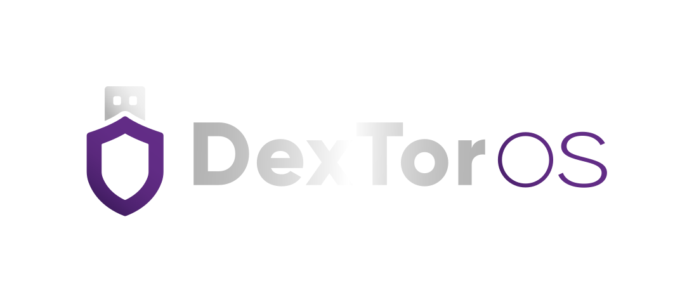
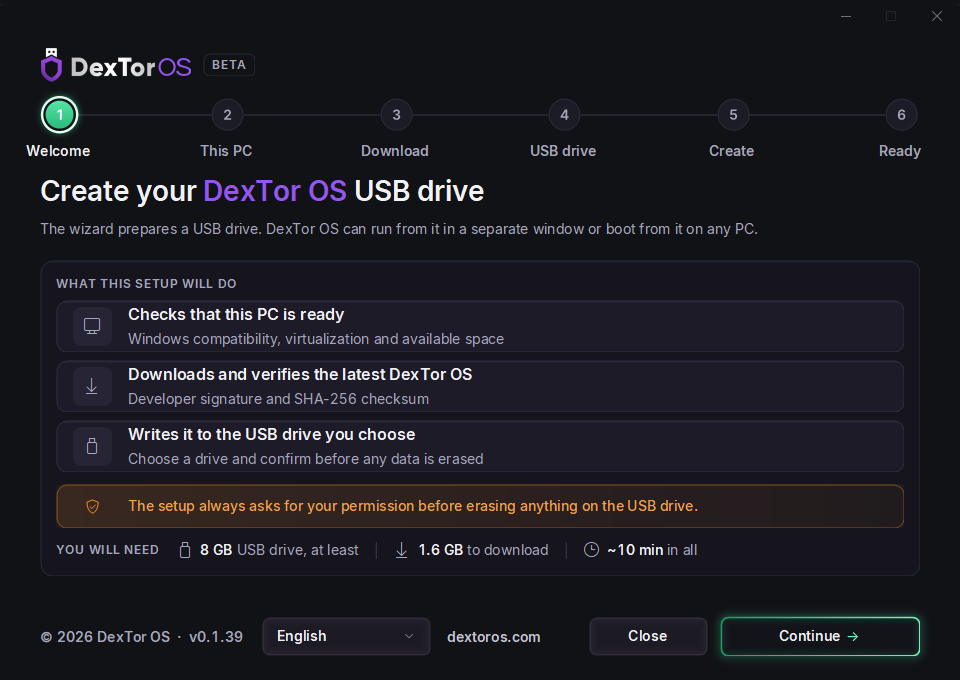
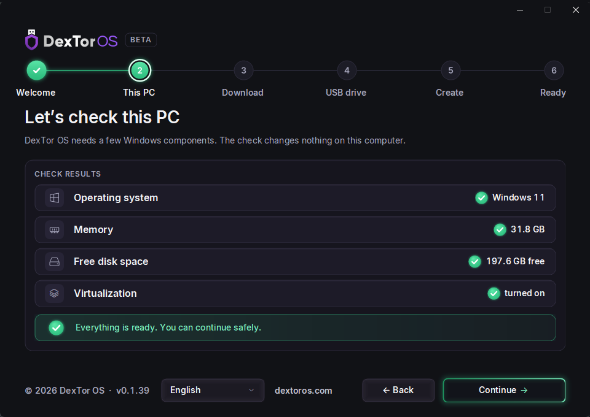
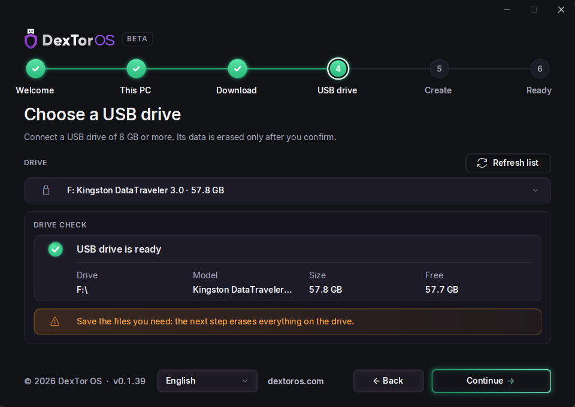
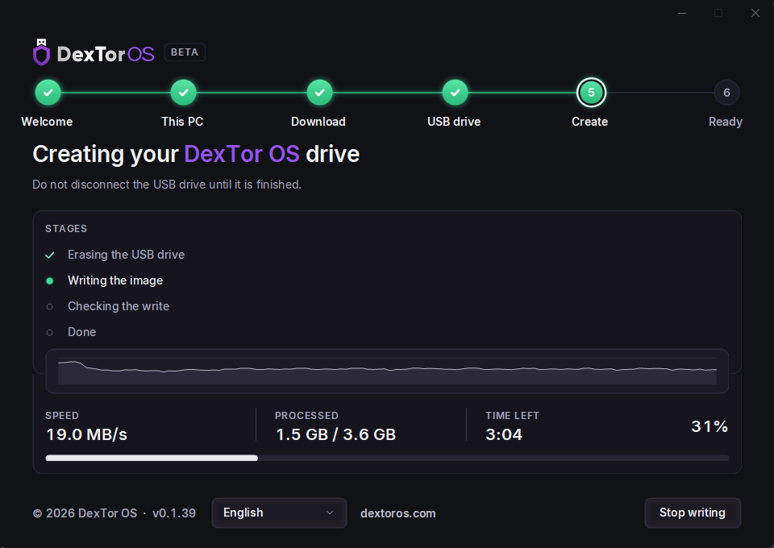
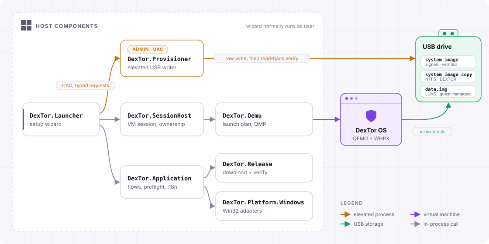

<div align="center">



# DexTor OS for Windows

**One USB drive. DexTor OS in a window on Windows or booted on a compatible PC.**

[](#requirements)
[](https://dotnet.microsoft.com/)
[](https://github.com/dextoros/dextor-launcher/releases)
[](LICENSE)

[Website](https://dextoros.com) · [Download](https://github.com/dextoros/dextor-launcher/releases) · [Report a bug](https://github.com/dextoros/dextor-launcher/issues/new?template=bug_report.yml) · [Suggest a feature](https://github.com/dextoros/dextor-launcher/issues/new?template=feature_request.yml)



</div>

---

The DexTor OS launcher is a single Windows program that turns an ordinary USB stick into a
DexTor OS drive, and then starts DexTor OS from it. The same stick works two ways:

- **Inside Windows** - DexTor OS runs in its own window on a pinned, verified QEMU with the
  Windows Hypervisor Platform. QEMU is downloaded and unpacked into a per-user cache;
  it is not added to the system `PATH`.
- **Direct boot** - on a compatible PC, restart and pick the stick in the boot menu.

Both modes provide the same `data.img` on the stick to DexTor OS. The guest OS is responsible
for setting up and unlocking its LUKS-encrypted storage; this repository contains the launcher
and documents the guest integration contract.

This repository is the complete source code of the launcher. We publish it so anyone can see
exactly what it does on a computer and to a USB drive - and what it does not.

## Highlights

|  |  |
|---|---|
| 🛡️ **Nothing is erased without asking** | Before any write you see the drive letter, physical disk, model and size, and confirm. System, boot, read-only and non-USB disks are refused outright. |
| ✅ **Verified image and USB writes** | The launcher verifies the published SHA-256 signature with its release key, checks the downloaded image against that hash, then verifies the raw USB write and the system-image copy before marking the drive ready. |
| 🔐 **Private storage** | A dedicated `data.img` is provided to DexTor OS for guest-managed LUKS encryption. The launcher prevents concurrent DexTor sessions for the same storage; it does not hold an exclusive file handle throughout the session. |
| 🧳 **Portable, no system-wide installation** | One self-contained `.exe`, no separate .NET installation required. Downloads, the QEMU runtime, settings and diagnostic logs are kept in `%LOCALAPPDATA%\DexTor`; QEMU is not added to `PATH`. |
| ⏯️ **Resumable and recoverable** | Downloads continue where they stopped. Creating a drive is a journaled transaction: after a crash or an unplugged stick it can be safely started again. |
| 🔑 **Administrator rights only when needed** | For USB writes, the portable executable starts a separate elevated process in provisioner mode; the wizard normally runs as you. Enabling Windows Hypervisor Platform also needs administrator approval. |
| 🌍 **10 languages** | English, Russian, Ukrainian, German, Spanish, French, Brazilian Portuguese, Polish, Turkish and Simplified Chinese - switched live, without a restart. |

## How it works

<table>
<tr>
<td width="50%"><br><sub><b>1. Check this PC</b> - Windows, memory, disk space and virtualization. The check changes nothing.</sub></td>
<td width="50%"><br><sub><b>2. Choose a USB drive</b> - after the latest image is downloaded and verified.</sub></td>
</tr>
<tr>
<td width="50%"><br><sub><b>3. Create</b> - erase, write, verify, with live progress.</sub></td>
<td width="50%"><b>4. Ready</b><br>After verification, start DexTor OS in Windows when virtualization is available, or boot from the stick on a compatible PC. Close DexTor OS before removing the USB drive.</td>
</tr>
</table>

Screenshots show the English v0.1.39 interface. Download sizes, timings and hardware
values are examples; direct boot depends on compatible hardware. The launcher does not
guarantee that guest data is erased at shutdown.

The finished stick is a hybrid drive: the verified DexTor OS live image with its own
UEFI/GRUB boot paths, plus an extra NTFS partition named `DEXTOR` holding a second copy of
the system image and the private `data.img`.

## Architecture

<picture>
  <source media="(prefers-color-scheme: dark)" srcset="docs/architecture-dark.svg">
  
</picture>

This is a logical component diagram, not a security boundary. QEMU and its guest VM run
on the Windows host. Session ownership prevents concurrent DexTor sessions; it is not
an exclusive file lock. Optional Windows Hypervisor Platform preparation also requires
administrator approval.

| Project | Responsibility |
|---|---|
| `DexTor.Domain` | States, events and invariants - no UI, no Win32, no QEMU |
| `DexTor.Contracts` | IPC and message contracts between processes |
| `DexTor.Application` | Use-case orchestration, preflight, localization catalog |
| `DexTor.Platform.Windows` | Win32 and device adapters |
| `DexTor.Release` | Release index, downloads and integrity checks |
| `DexTor.Creator` | Transactional USB creation |
| `DexTor.Provisioner` | The elevated USB-writing implementation |
| `DexTor.Qemu` | QEMU launch plan, QMP client, storage identity |
| `DexTor.SessionHost` | Runs and supervises the VM session, coordinates storage ownership |
| `DexTor.Updater` | Signed update flow |
| `DexTor.Support` | Support codes and diagnostic reports |
| `DexTor.Launcher` | The desktop wizard |

`guest/` documents the contract the DexTor OS side follows to find and open the private
storage in both modes.

## Requirements

- Windows 11 x64 (build 22000 or later)
- At least 6 GiB of memory, 8 GiB recommended; the VM receives 3–8 GiB depending on the host
- A USB drive of at least 8 GB, with enough capacity for two copies of the current OS image,
  at least 1 GiB of private storage and layout overhead - everything on it is erased
- Virtualization turned on, to run DexTor OS inside Windows; booting from the stick works without it
- Direct boot requires hardware and firmware supported by the selected DexTor OS image

## Files kept on the Windows host

The launcher retains the current image and QEMU runtime for reuse, settings, provisioning
journals and recent VM session logs in `%LOCALAPPDATA%\DexTor`. Cleanup removes obsolete
downloads and selected temporary files; it does not erase all application data after a session.
The .NET single-file runtime may also extract files into its own temporary cache.

To remove the launcher and its local cache, finish USB creation, close DexTor OS and the launcher,
then delete the portable executable and `%LOCALAPPDATA%\DexTor`. This does not erase the USB
drive or remove records Windows itself may retain, such as execution history or security logs.

## Verify a download

Download the portable executable from [GitHub Releases](https://github.com/dextoros/dextor-launcher/releases)
and compare its SHA-256 with the value in that exact release's notes:

```powershell
Get-FileHash -Algorithm SHA256 -LiteralPath '.\DexTorOS-Portable-VERSION-win-x64.exe'
```

Replace `VERSION` with the downloaded version. A matching hash checks file integrity;
it does not establish a trusted publisher. The v0.1.39 executable is unsigned. If the
hash differs, do not run the file; report the mismatch.

## Building from source

You need the [.NET 10 SDK](https://dotnet.microsoft.com/download/dotnet/10.0).

```powershell
.\scripts\check.ps1          # restore, build, run the full test suite
.\run-launcher.bat           # build and start the launcher
build-portable.bat 0.1.0     # one self-contained out\DexTorOS-Portable-0.1.0-win-x64.exe
```

Signing, the MSI and the bootstrapper are described in [`packaging/README.md`](packaging/README.md).

## Feedback

We welcome bug reports and ideas:

- 🐞 [Report a bug](https://github.com/dextoros/dextor-launcher/issues/new?template=bug_report.yml)
- 💡 [Suggest a feature](https://github.com/dextoros/dextor-launcher/issues/new?template=feature_request.yml)
- 🔒 Security issues - please report them privately, see [SECURITY.md](SECURITY.md)

We do not accept pull requests; see [CONTRIBUTING.md](CONTRIBUTING.md).

## License

DexTor OS for Windows is **source-available**, not open source. The code is published under the
[PolyForm Strict License 1.0.0](LICENSE): you may read, study and audit it, and use it for
personal and noncommercial purposes, but you may not distribute it, change it or build on it.

Third-party components keep their own licenses - see
[THIRD-PARTY-NOTICES.md](packaging/THIRD-PARTY-NOTICES.md).

<div align="center">
<sub>© 2026 DexTor OS Team · <a href="https://dextoros.com">dextoros.com</a></sub>
</div>
